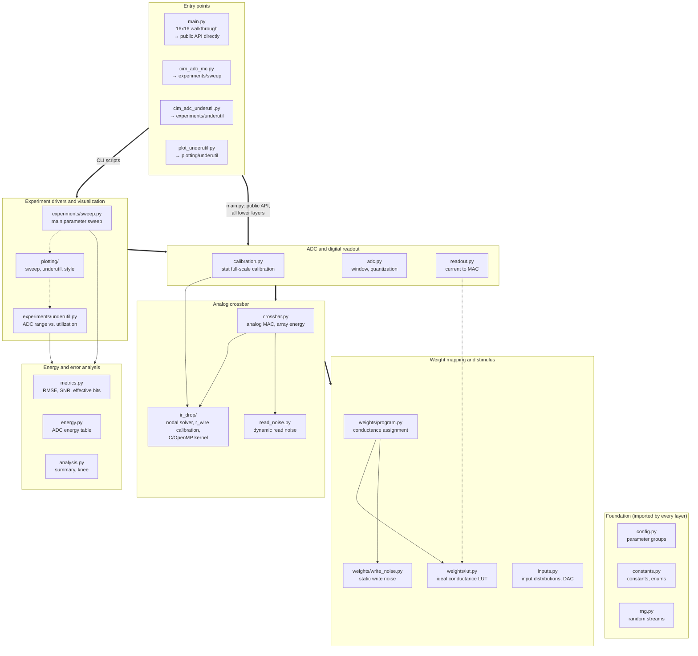
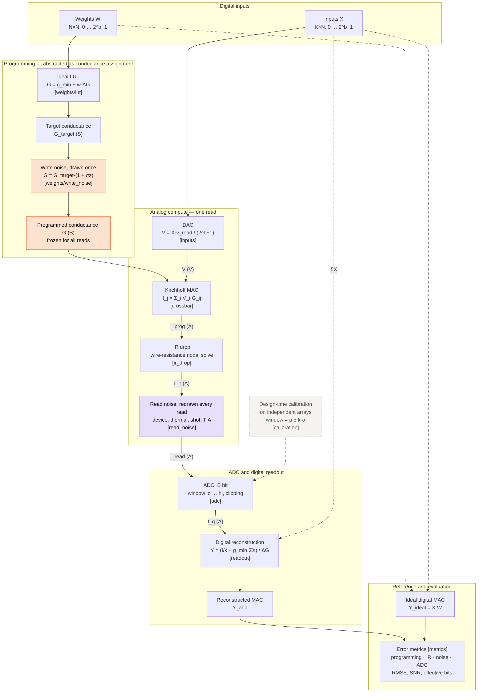

# cim_sim — Compute-Side Simulation of Memristor CIM Crossbars and ADC Resolution

`cim_sim` simulates the compute side of an analog compute-in-memory (CIM) macro: a memristor
crossbar performs the multiply-accumulate (MAC) in the analog domain, and per-column ADCs bring the
result back to the digital domain. The framework quantifies how programming error, IR drop, read
noise and ADC resolution jointly limit MAC accuracy and energy, and it drives the parameter sweeps
used to find the accuracy/energy optimum for the ADC bit width.

The package is a modular refactoring of `cim_adc_mc.py` (v3) and `cim_adc_underutil.py`. Physical
models, random-stream conventions and output formats are unchanged: with identical command-line
arguments, the refactored code reproduces `raw_trials.csv.gz`, `summary.csv`, `knee.csv` and
`ir_calibration.csv` of the original scripts bit for bit.

**Scope.** Only the compute side is modeled. Weight programming is abstracted as a conductance
assignment with a static, per-device error; write pulses, verify loops and device switching
dynamics are out of scope.

---

## Quick Start

### 1. Run the walkthrough

Requirements: Python ≥ 3.10, NumPy, SciPy, pandas, and `gcc` with OpenMP (the IR-drop kernel is
compiled automatically on first use). matplotlib is only needed for the plotting modules.

```bash
python main.py
```

`main.py` pushes one 16×16 array (4-bit weights and inputs, 2 % write error, 8-bit ADC, IR drop and
read noise enabled) through the complete signal chain in well under a second. It needs no external
data files and uses a fixed seed, so the output is identical on every run.

Useful variations:

```bash
python main.py --no-ir --no-noise          # programming error + ADC quantization only
python main.py --no-noise                  # add IR drop, keep reads noiseless
python main.py --fs-mode max --adc-bits 6  # worst-case ADC full scale, 6-bit ADC
python main.py --n 64 --input-dist sparse  # larger array, ReLU-like sparse activations
python main.py --help
```

### 2. Read the output

The console output follows the ten steps of the walkthrough. Each intermediate quantity is printed
with its shape, unit and value range (min / mean / max) so the physics can be sanity-checked at a
glance.

| Section | What it shows | Typical default values |
|---|---|---|
| Step 1 Configuration | Array size, resolutions, conductance window, read voltage and time, enabled non-idealities | 16×16, G ∈ [1, 100] µS, 0.2 V, 10 ns |
| Steps 2–5 Weights → conductance | Digital weights `W`, ideal LUT, target conductance `G_target`, programmed conductance `G`; realized write-error statistics | write-error std ≈ 2.0 % |
| Step 6 Inputs → DAC | Digital inputs `X` and read voltages `V` | V ∈ [0, 200] mV |
| Step 7 Crossbar MAC | Wire resistance per segment, column currents without/with IR drop, per-read noise σ, array read energy | r ≈ 0.76 Ω, attenuation ≈ 0.77 %, I ≈ 37–164 µA |
| Steps 8–9 ADC and readout | ADC window and LSB, clipping rates, quantized currents, reconstructed MAC; readout inversion check (must be ~1e-12) | window ≈ [5.5, 155] µA, LSB ≈ 0.59 µA |
| Step 10 Error metrics | RMS error contribution of each stage, pooled RMSE, SNR, signal- and full-scale-referred effective bits | SNR ≈ 23.8 dB, ≈ 3.7 signal-referred effective bits |

How to interpret the error breakdown in Step 10 (all values in MAC units, i.e. the same units as
`X @ W`):

- **programming error (static)** — deviation caused by write noise alone (`G ≠ G_target`).
- **IR drop increment** — additional error caused by wire resistance; mostly a systematic,
  position-dependent gain loss.
- **read noise increment (dynamic)** — additional error caused by read noise, which is redrawn on
  every read.
- **ADC quantization increment** — error added by quantization and clipping.
- **total** — error of the reconstructed digital output against the ideal integer MAC.

The stage increments do not add linearly; they combine roughly in quadrature. In the default
configuration, a small fraction of outputs exceeds the statistically calibrated ADC window (clipped
high ≈ 0.2 %). Those clipped outputs account for the large maximum absolute error, while the RMS
error is dominated by IR drop and programming error.

### 3. Locate the module to change

Each step of `main.py` calls exactly one module, so the step number, the walkthrough code and the
two diagrams below all point to the same place:

| Step | Physical operation | Module (public API) |
|---|---|---|
| 1 | Parameters, random streams | `config.py` (`DeviceParams`, `IRParams`, `NoiseParams`, `CalibParams`), `rng.py` (`point_streams`) |
| 2 | Digital weight matrix | `weights/program.py` (`sample_weight_levels`) |
| 3 | Ideal conductance LUT | `weights/lut.py` (`conductance_lut`) |
| 4 | Weight → target conductance | `weights/lut.py` (`levels_to_conductance`) |
| 5 | Write noise → programmed conductance | `weights/write_noise.py` (`sample_write_noise`, `apply_write_noise`) |
| 6 | Inputs and DAC | `inputs.py` (`sample_inputs`, `inputs_to_voltage`) |
| 7 | Crossbar MAC, IR drop, read noise | `crossbar.py` (`ideal_mvm`, `read_array_ir`), `ir_drop/` (`calibrate_r_wire`, `IRSolver`), `read_noise.py` |
| 8 | ADC full scale | `calibration.py` (`stat_calibration`), `adc.py` (`adc_window`) |
| 9 | Quantization and digital reconstruction | `adc.py` (`quantize`), `readout.py` (`current_to_mac`) |
| 10 | Error and energy metrics | `metrics.py` (`trial_metrics`, `pooled_metrics`), `energy.py` |

Workflow: find the physical effect you want to modify in **Figure 2**, note the module named in
the box, and then use **Figure 1** to see which other modules depend on it and therefore need to be
re-validated (for example, a change to `weights/write_noise.py` affects `crossbar.py`,
`calibration.py`, both experiment drivers and `main.py`).

---

## Architecture

Both diagrams are written in Mermaid and render directly on GitHub and GitLab. Pre-rendered copies are
in `docs/architecture_software.png` and `docs/dataflow_physical.png`.

### Figure 1 — Software architecture

Layers are ordered from entry points (top) to the foundation (bottom). Bold arrows are layer-level
dependencies, thin arrows are module-level imports inside or across layers, and dotted arrows are
optional or lazy imports. Every module imports only from its own layer or from layers below it, so
the physical models never depend on the experiment drivers. The foundation layer (`config`,
`constants`, `rng`) is imported throughout and is drawn without arrows for readability. The
experiment drivers additionally use the analog and weight layers through `crossbar.py` and
`calibration.py`.



### Figure 2 — Physical computation data flow

Data flow of one MAC operation from digital weights and inputs to the reconstructed digital output.
Orange nodes inject the **static** conductance error, which is fixed when the array is programmed and
identical for every subsequent read. Purple nodes inject **dynamic** error, which changes from read to
read. The dashed path is the design-time ADC calibration on independent arrays. The labels in
brackets name the implementing module.



Static and dynamic errors behave differently and are deliberately kept apart:

- **Static (programming) error** lives in the conductance matrix `G`. It is sampled once per array by
  `weights/write_noise.py` and therefore produces the same error pattern on every read of that
  array. Averaging repeated reads cannot remove it.
- **Dynamic (read) error** is sampled by `read_noise.py` independently for every read. Its standard
  deviation depends on the operating point (cell currents, column conductance, bandwidth
  `1/(2·t_read)`), so it is computed from the solved circuit state rather than from `G` alone.
- **IR drop** is deterministic for a given `G` and `V`; it acts mainly as a position-dependent gain
  loss and is solved exactly from the wire-resistance network.

---

## Directory layout

```
main.py                  End-to-end 16x16 walkthrough (start here)
cim_adc_mc.py            Main sweep entry point (same CLI as the original script)
cim_adc_underutil.py     Under-utilization experiment entry point (same CLI as the original script)
plot_underutil.py        Plots for the under-utilization experiment
ADC_22nm_energy_vs_bits.csv   ADC energy table used by the sweep (not needed by main.py)
cim_sim/
  constants.py           Physical constants; enums for input distributions, energy tiers, FS modes
  config.py              Parameter groups and SweepConfig (field names match the original Config)
  rng.py                 Random-stream convention per (b, sigma, N) point
  weights/
    lut.py               (1) Ideal weight LUT: integer level -> target conductance
    write_noise.py       (2) Write noise: sample (1 + sigma*z), apply to target conductance
    program.py           (3) Conductance assignment: random or given weights -> LUT -> write noise
  inputs.py              Input distributions, analytic moments, DAC mapping
  ir_drop/
    crossbar_ir.c        C/OpenMP block-SOR kernel
    kernel.py            Kernel compilation and loading
    solver.py            IRSolver, exact_solve, solve_crossbar
    calibrate.py         Target attenuation A(N) and equivalent wire-resistance calibration
  read_noise.py          Device read noise, thermal, shot and TIA input noise
  crossbar.py            Analog MAC: combines weights, IR drop and read noise; array read energy
  calibration.py         ADC full-scale "stat" calibration (semi-analytic or sampled)
  adc.py                 Full-scale windows (max / stat) and ideal quantization
  readout.py             Current -> integer MAC; per-column digital gain correction
  energy.py              ADC energy table and energy columns
  metrics.py             Effective bits, SNR, error decomposition
  analysis.py            Summary aggregation and knee extraction
  selfcheck.py           Self-tests
  experiments/sweep.py      Main sweep driver
  experiments/underutil.py  Under-utilization driver
  plotting/              Figures
```

## Command-line usage (unchanged from the original scripts)

```bash
python cim_adc_mc.py --energy-csv ADC_22nm_energy_vs_bits.csv --out results_v3
python cim_adc_mc.py --r-wire 0 --no-noise --out results_ideal
python cim_adc_mc.py --resummarize --out results_v3
python cim_adc_underutil.py --mem-bits 4 --out res_b4
python plot_underutil.py res_b4
python -m cim_sim.selfcheck
```

## Programmatic use

Low-level functions take explicit scalar arguments (units are given in each docstring). Mid-level
functions take the parameter-group dataclasses; every group provides `.as_kwargs()` to expand into
low-level calls. `main.py` is the reference for composing the public API step by step.

A complete sweep from Python:

```python
from cim_sim import SweepConfig
from cim_sim.experiments.sweep import run_sweep, simulate_point

cfg = SweepConfig(sizes=[16, 32], mem_bits=[4], mem_sigma=[0.02], n_mc=50, out_dir="res_tiling")
raw, summary = run_sweep(cfg)
```

## Where to make common changes

| Change | Location |
|---|---|
| Non-linear level placement, measured level table, differential pairs | Pass a custom `lut` (`weights/lut.py`); `program_arrays`, `simulate_crossbar` and `stat_calibration` all accept `lut=` |
| Write-noise model (level-dependent σ, log-normal, …) | `weights/write_noise.py` |
| Map trained network weights onto the array | `program_arrays(..., W=integer_weights)` |
| New ADC full-scale strategy | Add a window function to `adc.py`; under-utilization strategies live in `experiments/underutil.py::strategy_window` |
| Tiling / partitioning experiments | Add a driver under `experiments/` that reuses `simulate_crossbar`, `quantize` and `metrics` |
| Remove digital gain correction (`*_cal`, `*_chip`) | `readout.apply_column_gain` is called only in `experiments/sweep.py::simulate_point`; delete those two blocks |

## Reproducibility and validation

- All randomness flows through `rng.py`. Each sweep point `(b, σ, N)` owns independent streams for
  array programming, inputs, calibration arrays and read noise, so the same point sees the same
  weights, device errors and inputs in every experiment.
- `main.py` uses the same streams. Its step-by-step chain reproduces `weights.program_arrays` and
  `crossbar.simulate_crossbar` exactly for the same seed.
- `python -m cim_sim.selfcheck` checks the LUT round trip, exact MAC recovery on an ideal chain, the
  iterative IR solver against a sparse direct solve, Kirchhoff's current law, the ADC and the input
  distribution moments.

## Notes

- `ir_drop/calibrate.py::reference_case` computes the reference conductances with the original
  expression `g_min + W·(g_max − g_min)/L` instead of the LUT, so that r_eff(N) matches v3 bit for bit
  (the two expressions differ only in floating-point rounding).
- The C kernel is cached by source hash in `$TMPDIR/cim_sim_kernel/`. Set `CIM_SIM_KERNEL_DIR` and
  `CIM_SIM_CC` to override the cache directory and the compiler.
- `main.py` reports array read energy only; ADC conversion energy requires the external energy table
  and is handled by the sweep (`energy.py`).
