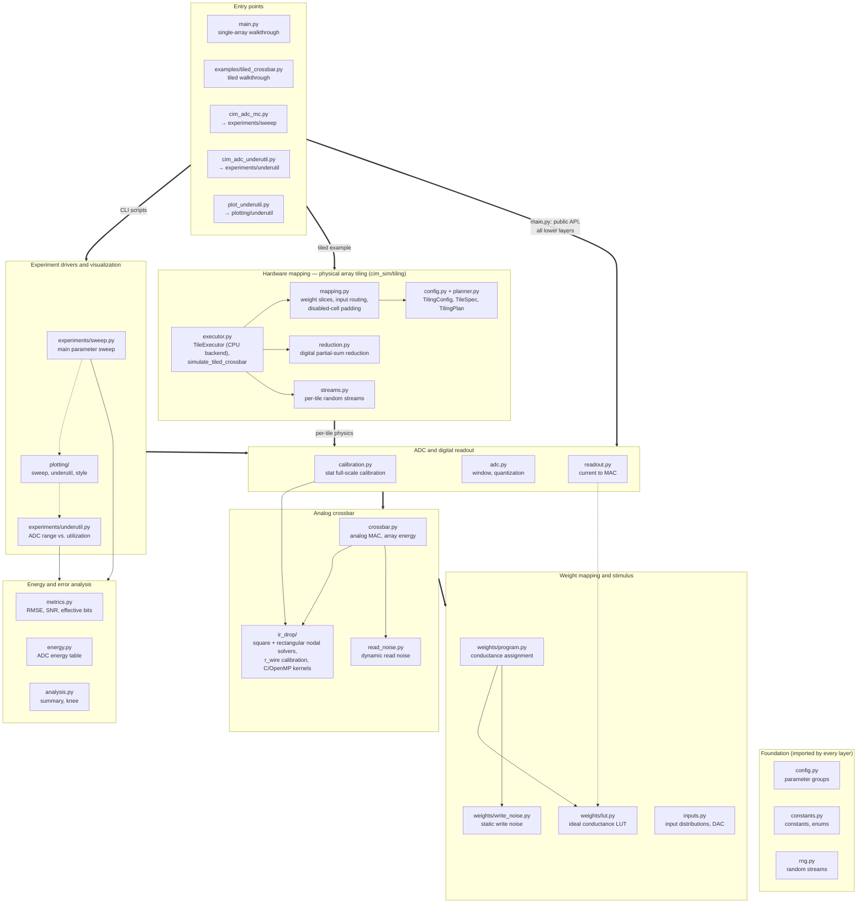
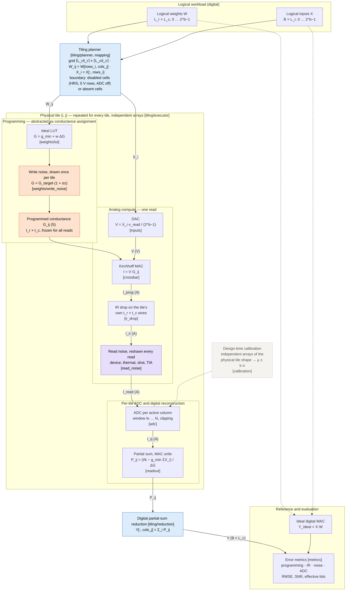

# cim_sim — Compute-Side Simulation of Memristor CIM Crossbars and ADC Resolution

**Current version: V5** (repository root). The previous version is preserved in
[V4/](V4/README.md). Run the commands below from the repository root; to run the
archived version, first change into `V4/`.

`cim_sim` simulates the compute side of an analog compute-in-memory (CIM) macro: a memristor
crossbar performs the multiply-accumulate (MAC) in the analog domain, and per-column ADCs bring the
result back to the digital domain. The framework quantifies how programming error, IR drop, read
noise and ADC resolution jointly limit MAC accuracy and energy, and it drives the parameter sweeps
used to find the accuracy/energy optimum for the ADC bit width.

Two levels of abstraction are supported:

- **Single physical array** — one N×N crossbar (`main.py`, the parameter sweeps).
- **Physical array tiling** — a logical weight matrix of any size executed on a grid of independent
  physical crossbars, for example a 512×512 layer on 1024 arrays of 16×16, with per-tile analog
  compute, per-tile ADCs and digital partial-sum reduction (`cim_sim/tiling`,
  `examples/tiled_crossbar.py`).

The package is a modular refactoring of `cim_adc_mc.py` (v3) and `cim_adc_underutil.py`. Physical
models, random-stream conventions and output formats are unchanged: with identical command-line
arguments, the package reproduces `raw_trials.csv.gz`, `summary.csv`, `knee.csv` and
`ir_calibration.csv` of the original scripts (checked by `tests/test_regression.py`;
see [comparison tolerances](tests/golden/README.md) for full-precision floating-point portability).

**Scope.** Only the compute side is modeled. Weight programming is abstracted as a conductance
assignment with a static, per-device error; write pulses, verify loops and device switching
dynamics are out of scope.

---

## Quick Start

### 1. Run the single-array walkthrough

Requirements: Python ≥ 3.10, NumPy, SciPy, pandas, and `gcc` with OpenMP (the IR-drop kernels are
compiled automatically on first use). matplotlib is only needed for the plotting modules.

```bash
python main.py
```

`main.py` pushes one 16×16 array (4-bit weights and inputs, 2 % write error, 8-bit ADC, IR drop and
read noise enabled) through the complete signal chain in well under a second. It needs no external
data files and uses a fixed seed, so the output is identical on every run.

Useful variations:

```bash
python main.py --no-ir --no-noise          # programming error + ADC quantization only
python main.py --no-noise                  # add IR drop, keep reads noiseless
python main.py --fs-mode max --adc-bits 6  # worst-case ADC full scale, 6-bit ADC
python main.py --n 64 --input-dist sparse  # larger array, ReLU-like sparse activations
python main.py --help
```

### 2. Run the tiled walkthrough

```bash
python examples/tiled_crossbar.py                          # 64x64 logical matrix on 16x16 tiles
python examples/tiled_crossbar.py --logical 512 512 --batch 16
```

See [Physical Array Tiling](#physical-array-tiling) for the model and more options.

### 3. Read the output of `main.py`

The console output follows the ten steps of the walkthrough. Each intermediate quantity is printed
with its shape, unit and value range (min / mean / max) so the physics can be sanity-checked at a
glance.

| Section | What it shows | Typical default values |
|---|---|---|
| Step 1 Configuration | Array size, resolutions, conductance window, read voltage and time, enabled non-idealities | 16×16, G ∈ [1, 100] µS, 0.2 V, 10 ns |
| Steps 2–5 Weights → conductance | Digital weights `W`, ideal LUT, target conductance `G_target`, programmed conductance `G`; realized write-error statistics | write-error std ≈ 2.0 % |
| Step 6 Inputs → DAC | Digital inputs `X` and read voltages `V` | V ∈ [0, 200] mV |
| Step 7 Crossbar MAC | Wire resistance per segment, column currents without/with IR drop, per-read noise σ, array read energy | r ≈ 0.76 Ω, attenuation ≈ 0.77 %, I ≈ 37–164 µA |
| Steps 8–9 ADC and readout | ADC window and LSB, clipping rates, quantized currents, reconstructed MAC; readout inversion check (must be ~1e-12) | window ≈ [5.5, 155] µA, LSB ≈ 0.59 µA |
| Step 10 Error metrics | RMS error contribution of each stage, pooled RMSE, SNR, signal- and full-scale-referred effective bits | SNR ≈ 23.8 dB, ≈ 3.7 signal-referred effective bits |

How to interpret the error breakdown in Step 10 (all values in MAC units, i.e. the same units as
`X @ W`):

- **programming error (static)** — deviation caused by write noise alone (`G ≠ G_target`).
- **IR drop increment** — additional error caused by wire resistance; mostly a systematic,
  position-dependent gain loss.
- **read noise increment (dynamic)** — additional error caused by read noise, which is redrawn on
  every read.
- **ADC quantization increment** — error added by quantization and clipping.
- **total** — error of the reconstructed digital output against the ideal integer MAC.

The stage increments do not add linearly; they combine roughly in quadrature. In the default
configuration, a small fraction of outputs exceeds the statistically calibrated ADC window (clipped
high ≈ 0.2 %). Those clipped outputs account for the large maximum absolute error, while the RMS
error is dominated by IR drop and programming error.

### 4. Locate the module to change

Each step of `main.py` calls exactly one module, so the step number, the walkthrough code and the
two diagrams below all point to the same place:

| Step | Physical operation | Module (public API) |
|---|---|---|
| 1 | Parameters, random streams | `config.py` (`DeviceParams`, `IRParams`, `NoiseParams`, `CalibParams`), `rng.py` (`point_streams`) |
| 2 | Digital weight matrix | `weights/program.py` (`sample_weight_levels`) |
| 3 | Ideal conductance LUT | `weights/lut.py` (`conductance_lut`) |
| 4 | Weight → target conductance | `weights/lut.py` (`levels_to_conductance`) |
| 5 | Write noise → programmed conductance | `weights/write_noise.py` (`sample_write_noise`, `apply_write_noise`) |
| 6 | Inputs and DAC | `inputs.py` (`sample_inputs`, `inputs_to_voltage`) |
| 7 | Crossbar MAC, IR drop, read noise | `crossbar.py` (`ideal_mvm`, `read_array_ir`, `read_array`), `ir_drop/` (`calibrate_r_wire`, `IRSolver`, `RectIRSolver`), `read_noise.py` |
| 8 | ADC full scale | `calibration.py` (`stat_calibration`), `adc.py` (`adc_window`) |
| 9 | Quantization and digital reconstruction | `adc.py` (`quantize`), `readout.py` (`current_to_mac`) |
| 10 | Error and energy metrics | `metrics.py` (`trial_metrics`, `pooled_metrics`), `energy.py` |
| — | Logical-to-physical mapping, partial-sum reduction | `tiling/` (`plan_tiling`, `simulate_tiled_crossbar`, `DigitalReducer`) |

Workflow: find the physical effect you want to modify in **Figure 2**, note the module named in
the box, and then use **Figure 1** to see which other modules depend on it and therefore need to be
re-validated (for example, a change to `weights/write_noise.py` affects `crossbar.py`,
`calibration.py`, the tile executor, both experiment drivers and `main.py`).

---

## Architecture

Both diagrams are written in Mermaid and render directly on GitHub and GitLab. Pre-rendered copies are
in `docs/architecture_software.png` and `docs/dataflow_physical.png`.

### Figure 1 — Software architecture

Layers are ordered from entry points (top) to the foundation (bottom). Bold arrows are layer-level
dependencies, thin arrows are module-level imports inside or across layers, and dotted arrows are
optional or lazy imports. Every module imports only from its own layer or from layers below it, so
the physical models never depend on the tiling layer or on the experiment drivers. The foundation
layer (`config`, `constants`, `rng`) is imported throughout and is drawn without arrows for
readability. The experiment drivers and the tiling executor reach the analog and weight layers
through `crossbar.py`, `calibration.py`, `weights` and `inputs`.



### Figure 2 — Physical computation data flow

Data flow from the logical weights and inputs to the reconstructed digital output. The tiling
planner sits between the logical matrix and the physical crossbars; every tile is an independent
physical array that runs the complete single-array chain, and the partial sums meet only in the
digital reduction. A single array (`main.py`) is the special case of a 1×1 tile grid.

Orange nodes inject the **static** conductance error, fixed when a tile is programmed and identical
for every subsequent read. Purple nodes inject **dynamic** error, which changes from read to read.
Blue nodes belong to the tiling layer. The dashed path is the design-time ADC calibration on
independent arrays. Labels in brackets name the implementing module.



Static and dynamic errors behave differently and are deliberately kept apart:

- **Static (programming) error** lives in the conductance matrix `G` of each physical array. It is
  sampled once per array by `weights/write_noise.py` and therefore produces the same error pattern on
  every read of that array. Averaging repeated reads cannot remove it.
- **Dynamic (read) error** is sampled by `read_noise.py` independently for every read. Its standard
  deviation depends on the operating point (cell currents, column conductance, bandwidth
  `1/(2·t_read)`), so it is computed from the solved circuit state rather than from `G` alone.
- **IR drop** is deterministic for a given `G` and `V`; it acts mainly as a position-dependent gain
  loss and is solved exactly from the wire-resistance network of each physical array.

---

## Physical Array Tiling

### Logical matrix vs. physical crossbar

- The **logical matrix** `W` (shape `L_r × L_c`) is the workload, e.g. one 512×512 layer. It decides
  how much computation is done.
- A **physical crossbar** (tile, shape `t_r × t_c`) is one real array with its own word lines, bit
  lines, row drivers, TIAs and column ADCs. It decides the analog behavior: IR drop is solved on the
  tile's own `t_r × t_c` wire network, the read-noise model sees the tile's own column conductance,
  and every active column is digitized by the tile's own ADC.

Tiling is **not** memory blocking and **not** an approximation that cuts one large resistive network
into pieces. It models an architecture in which `⌈L_r/t_r⌉ × ⌈L_c/t_c⌉` physically independent arrays
together implement the logical matrix. The physical modules (`crossbar`, `ir_drop`, `read_noise`,
`adc`, `readout`) never learn the logical size; they only receive one tile's operands.

### Example: 512×512 on 16×16 tiles

```python
import numpy as np
from cim_sim import IRParams, NoiseParams
from cim_sim.inputs import sample_inputs
from cim_sim.tiling import TileADCParams, plan_tiling, simulate_tiled_crossbar, workload_rng
from cim_sim.weights import sample_weight_levels

plan = plan_tiling(logical_shape=(512, 512), tile_shape=(16, 16), reduction_mode="digital")
print(plan.describe())          # 32 x 32 = 1024 tiles, 16384 ADC conversions per input vector

rng = workload_rng(seed=1, bits=4, logical_shape=(512, 512))
W = sample_weight_levels(rng, (512, 512), n_levels=16)          # integer levels 0..15
X = sample_inputs(rng, "uniform", 4, (16, 512))                  # (batch, logical_rows)

res = simulate_tiled_crossbar(W, X, plan, bits=4, sigma=0.02, ir=IRParams(), noise=NoiseParams(),
                              adc=TileADCParams(bits=8, fs_mode="stat"))
res.Y              # (16, 512) reconstructed digital MAC
res.partial_sums   # (32, 16, 512) digital partial sums of each tile row
```

`python examples/tiled_crossbar.py --logical 512 512 --batch 16` runs this configuration with all
non-idealities in about 1.5 s on a 2-core CPU. It reports 1024 tiles, r_wire = 0.76 Ω per
segment (the calibrated value of a stand-alone 16×16 array), 0.75 % mean IR attenuation per tile and
16384 ADC conversions per input vector, against 512 for a single monolithic 512×512 array.

### Tile mapping and partial sums

For grid position `(i, j)` the planner assigns

```
rows_i = [i·t_r, min((i+1)·t_r, L_r))          cols_j = [j·t_c, min((j+1)·t_c, L_c))
W_ij   = W[rows_i, cols_j]                     X_i   = X[:, rows_i]
P_ij   = X_i @ W_ij                            (computed by physical tile (i, j))
Y[:, cols_j] = Σ_i P_ij                        (reduction over the tile column j)
```

`TilingPlan` exposes every relation explicitly: `tile(i, j)`, `row_block(i)` (tiles sharing an input
slice), `col_block(j)` (tiles reduced into one output block), `physical_shapes()`, `layout()`,
`layout_table()`, `n_tiles`, `adc_conversions_per_vector`, `cell_utilization`.

Each tile digitizes its own column currents, and `readout.current_to_mac` converts them to MAC units
with that tile's **own** input sum:

```
P_ij = (I_q / k − g_min · Σ_{r ∈ rows_i} x_r) / ΔG,     k = v_read / (2^b − 1),  ΔG = (g_max − g_min) / (2^b − 1)
```

The `g_min` baseline of every logical input is therefore removed exactly once, by the tile that
receives that input. Disabled rows carry `x = 0` and add no baseline. All tiles share `b`, `g_min`,
`g_max` and `v_read`, so their partial sums are on the same MAC scale before they are added. The
reducer stores the partial sums per tile row and adds them in a fixed order, which makes the result
independent of the tile execution order.

### Digital vs. analog reduction

| Mode | Where partial sums meet | Status |
|---|---|---|
| `digital` | Each tile converts its column currents with its own ADCs; partial sums are added digitally. Cost: one ADC conversion per active tile column. | Implemented (default) |
| `analog` | Tile currents or charges of a tile column are merged in the analog domain before one shared ADC. Requires a model of the summing circuit, its loading and noise, and a new ADC full scale. | Reserved: raises `NotImplementedError` |
| `hierarchical` | Groups of tiles are merged in the analog domain, groups are reduced digitally. | Reserved: raises `NotImplementedError` |

The reserved modes deliberately do not fall back to adding ideal currents before the ADC, because
that would ignore the peripheral circuit that a physical analog merge needs.
`plan_tiling(..., reduction_mode="analog")` is accepted so that plans can be prepared, but
`simulate_tiled_crossbar` stops before running any tile. New modes are added by implementing a
`Reducer` in `tiling/reduction.py` (and, for analog modes, a peripheral-circuit model).

### Non-divisible sizes

When `L_r` or `L_c` is not a multiple of the tile size, the last tile row/column is only partly
used. Two edge policies are available:

- **`disabled`** (default, uniform hardware): every tile is a full `t_r × t_c` array. Cells outside
  the valid region physically exist and are programmed to `disabled_level` (default level 0, i.e.
  `g_min`, the highest-resistance state, with the same write variability as any other cell). Unused
  rows are driven at 0 V, so they inject no signal current and no drive energy; the ADCs of unused
  columns are switched off and are not counted as conversions. The disabled cells still load the
  word and bit lines in the IR-drop solution and add conductance to the column noise model (thermal
  and TIA noise), as they would in silicon. Active rows also deliver current into the disabled
  columns' high-resistance cells, which is included in the array read energy.
- **`absent`**: boundary tiles are physically smaller arrays of exactly the valid shape (custom edge
  macros). Their IR drop is solved on the smaller (possibly rectangular) wire network with the same
  per-segment wire resistance, and their ADC full scale is calibrated for their own shape.

Rectangular arrays are solved by `ir_drop.RectIRSolver` (separate C kernel `crossbar_ir_rect.c`;
square arrays keep using the original `IRSolver`). The calibrated wire resistance
(`IRParams(r_wire < 0)`) follows the square-array law r_eff(N); for rectangular tiles pass an explicit
`IRParams(r_wire=<Ohm per segment>)`, otherwise a `ValueError` explains the choice.

### Running the tiled example

```bash
python examples/tiled_crossbar.py                                   # 64x64 on 16x16 tiles
python examples/tiled_crossbar.py --logical 35 50 --tile 16 16       # edge tiles, disabled cells
python examples/tiled_crossbar.py --logical 35 50 --edge-policy absent
python examples/tiled_crossbar.py --tile 8 16 --r-wire 0.8           # rectangular tiles
python examples/tiled_crossbar.py --no-ir --no-noise --adc-bits 10
python examples/tiled_crossbar.py --help
```

The output contains the tiling plan and a tile-grid map, the shape of every stage (logical operands,
per-tile operands, conductances, currents, partial sums, output), a partial-sum reconstruction of
one output element, the error breakdown (programming / IR / read noise / ADC), RMSE, SNR and
effective bits against `X @ W`, and the cost per input vector (ADC conversions, array read energy,
and ADC energy when `--energy-csv` is given). Large configurations print only summaries; no matrix is
printed in full.

### Tile size and ADC experiments

The logical workload is drawn from `workload_rng(seed, bits, logical_shape)`, which does not depend
on the tile shape, so different tilings are compared on identical `W` and `X`. `--tile-sweep`
evaluates several square tile sizes in one run:

```bash
python examples/tiled_crossbar.py --logical 512 512 --batch 16 \
    --tile-sweep 16 32 64 128 256 512 --energy-csv ADC_22nm_energy_vs_bits.csv
```

| Tile | Tiles | r_wire (Ω) | IR att. | SNR (dB) | ADC conv. / vector | E_array (pJ) | E_ADC, 8 bit (pJ) |
|---|---|---|---|---|---|---|---|
| 16×16 | 1024 | 0.761 | 0.75 % | 12.31 | 16384 | 1790 | 16531 |
| 32×32 | 256 | 0.269 | 1.00 % | 9.90 | 8192 | 1787 | 8266 |
| 64×64 | 64 | 0.100 | 1.43 % | 6.79 | 4096 | 1780 | 4133 |
| 128×128 | 16 | 0.035 | 1.98 % | 4.02 | 2048 | 1772 | 2066 |
| 256×256 | 4 | 0.012 | 2.74 % | 1.16 | 1024 | 1760 | 1033 |
| 512×512 | 1 | 0.004 | 3.81 % | −1.71 | 512 | 1744 | 517 |

(4-bit weights and inputs, σ = 2 %, uniform inputs, stat full scale, IR drop and read noise on.)
Smaller tiles shorten the wires and reduce the IR-drop gain loss, but they multiply the number of
ADC conversions. Because IR drop is a systematic gain loss, the partial-sum errors of a tile column
add coherently in the digital reduction, which keeps the signal-referred SNR of a 512-row logical
matrix well below that of a single 16×16 array. To explore the trade-off:

- change the tile shape with `--tile R C` or `plan_tiling(tile_shape=...)`;
- change the per-tile ADC with `--adc-bits` / `--fs-mode` or `TileADCParams(bits, fs_mode)`;
- change the interconnect with `--r-wire` or `IRParams(r_wire=...)`;
- combine accuracy with `res.adc_conversions × E_ADC(bits)` from `energy.load_adc_energy` and with
  `res.E_array` for the energy side.

### Execution model and backends

`simulate_tiled_crossbar` builds one `TileJob` per tile (integer weight levels, routed input codes,
global sample indices, ADC window) and hands the jobs to a `TileExecutor`. `CPUTileExecutor` runs them
one after another with the existing physical modules:
`weights.program_arrays → inputs.inputs_to_voltage → crossbar.read_array → read_noise.add_read_noise
→ adc.quantize`. The reducer consumes `TileResult`s in any order.

Random streams are owned by the tiling layer (`tiling/streams.py`) and never change `cim_sim.rng`:
the write noise of a tile is keyed by its physical shape and grid position, the read noise by tile
and global sample index, and the ADC calibration arrays by the physical shape. Results are therefore
identical for any tile order and any batch chunking (`CPUTileExecutor(batch_chunk=...)`), and an
input stream can be split over several calls with `sample_offset`. With IR drop enabled, batch
chunking changes the iterative solution only within the solver tolerance.

To add a GPU backend, implement:

- `TileExecutor.execute(jobs, ctx, streams)`: batch many `TileJob`s on the device. The planner,
  mapping, reduction and result types stay unchanged.
- The physics behind `crossbar.read_array` for batched tiles: the ideal path is a batched GEMM, and the
  IR path needs a batched nodal solver equivalent to `ir_drop.IRSolver` / `RectIRSolver`.
- A `TileStreamProvider` (`programming`, `read_noise`, `calibration`) backed by a counter-based
  generator keyed by the same tuples. Bit-identical results across generators are not expected.

---

## Directory layout

```
main.py                  Single-array end-to-end walkthrough (start here)
examples/
  tiled_crossbar.py      Tiled walkthrough: logical matrix on a grid of physical tiles
cim_adc_mc.py            Main sweep entry point (same CLI as the original script)
cim_adc_underutil.py     Under-utilization experiment entry point (same CLI as the original script)
plot_underutil.py        Plots for the under-utilization experiment
ADC_22nm_energy_vs_bits.csv   ADC energy table used by the sweep (optional for the examples)
cim_sim/
  constants.py           Physical constants; enums for input distributions, energy tiers, FS modes
  config.py              Parameter groups and SweepConfig (field names match the original Config)
  rng.py                 Random-stream convention per (b, sigma, N) point
  weights/
    lut.py               (1) Ideal weight LUT: integer level -> target conductance
    write_noise.py       (2) Write noise: sample (1 + sigma*z), apply to target conductance
    program.py           (3) Conductance assignment: random or given weights -> LUT -> write noise
  inputs.py              Input distributions, analytic moments, DAC mapping
  ir_drop/
    crossbar_ir.c        C/OpenMP block-SOR kernel, square arrays (unchanged)
    crossbar_ir_rect.c   C/OpenMP block-SOR kernel, rectangular arrays
    kernel.py            Kernel compilation and loading
    solver.py            IRSolver, exact_solve, solve_crossbar
    rect.py              RectIRSolver, exact_solve_rect, make_ir_solver
    calibrate.py         Target attenuation A(N) and equivalent wire-resistance calibration
  read_noise.py          Device read noise, thermal, shot and TIA input noise
  crossbar.py            Analog MAC: combines weights, IR drop and read noise; array read energy
  calibration.py         ADC full-scale "stat" calibration (semi-analytic or sampled)
  adc.py                 Full-scale windows (max / stat) and ideal quantization
  readout.py             Current -> integer MAC; per-column digital gain correction
  energy.py              ADC energy table and energy columns
  metrics.py             Effective bits, SNR, error decomposition
  analysis.py            Summary aggregation and knee extraction
  selfcheck.py           Self-tests
  tiling/
    config.py            TilingConfig, TileADCParams, reduction modes, edge policies
    planner.py           TileSpec, TilingPlan, plan_tiling (geometry only)
    mapping.py           Weight slicing / padding, input routing, operand validation
    streams.py           Order-independent per-tile random streams
    reduction.py         Digital partial-sum reduction; reserved analog / hierarchical modes
    executor.py          TileExecutor, CPUTileExecutor, simulate_tiled_crossbar
  experiments/sweep.py      Main sweep driver
  experiments/underutil.py  Under-utilization driver
  plotting/              Figures
tests/
  test_tiling.py         Tiling: ideal correctness, physical consistency, edge cases, random streams
  test_regression.py     Golden regression against the original scripts (tests/golden/)
docs/                    Pre-rendered architecture diagrams
```

## Command-line usage (unchanged from the original scripts)

```bash
python cim_adc_mc.py --energy-csv ADC_22nm_energy_vs_bits.csv --out results_v3
python cim_adc_mc.py --r-wire 0 --no-noise --out results_ideal
python cim_adc_mc.py --resummarize --out results_v3
python cim_adc_underutil.py --mem-bits 4 --out res_b4
python plot_underutil.py res_b4
python -m cim_sim.selfcheck
```

## Testing

The tests use the standard-library `unittest` runner (pytest also collects them):

```bash
python -m unittest discover -s tests -v       # all tests, about 4 s
python -m unittest tests.test_tiling -v       # tiling only
python -m unittest tests.test_regression -v   # golden regression + selfcheck + main.py output
```

## Programmatic use

Low-level functions take explicit scalar arguments (units are given in each docstring). Mid-level
functions take the parameter-group dataclasses; every group provides `.as_kwargs()` to expand into
low-level calls. `main.py` is the reference for composing the public API step by step, and
`examples/tiled_crossbar.py` for the tiling layer.

A complete sweep from Python:

```python
from cim_sim import SweepConfig
from cim_sim.experiments.sweep import run_sweep, simulate_point

cfg = SweepConfig(sizes=[16, 32], mem_bits=[4], mem_sigma=[0.02], n_mc=50, out_dir="res")
raw, summary = run_sweep(cfg)
```

## Where to make common changes

| Change | Location |
|---|---|
| Non-linear level placement, measured level table, differential pairs | Pass a custom `lut` (`weights/lut.py`); `program_arrays`, `simulate_crossbar`, `stat_calibration` and `simulate_tiled_crossbar` all accept `lut=` |
| Write-noise model (level-dependent σ, log-normal, …) | `weights/write_noise.py` |
| Map trained network weights onto the array | `program_arrays(..., W=integer_weights)`, or `simulate_tiled_crossbar(W, X, plan, ...)` for layers larger than one array |
| New ADC full-scale strategy | Add a window function to `adc.py`; under-utilization strategies live in `experiments/underutil.py::strategy_window`, the per-tile window in `tiling/executor.py::tile_adc_window` |
| Tile shape, edge handling, logical-to-physical mapping | `tiling/planner.py`, `tiling/mapping.py` |
| Analog or hierarchical partial-sum reduction | New `Reducer` in `tiling/reduction.py` (plus a peripheral-circuit model) |
| GPU or other execution backend | New `TileExecutor` and `TileStreamProvider` (see *Execution model and backends*) |
| Remove digital gain correction (`*_cal`, `*_chip`) | `readout.apply_column_gain` is called only in `experiments/sweep.py::simulate_point`; delete those two blocks |

## Reproducibility and validation

- All randomness of the single-array experiments flows through `rng.py`. Each sweep point
  `(b, σ, N)` owns independent streams for array programming, inputs, calibration arrays and read
  noise, so the same point sees the same weights, device errors and inputs in every experiment.
- Tiled runs use their own streams (`tiling/streams.py`, tagged so they never collide with `rng.py`);
  see *Execution model and backends*.
- `main.py` uses the `rng.py` streams. Its step-by-step chain reproduces `weights.program_arrays` and
  `crossbar.simulate_crossbar` exactly for the same seed. A 1×1 tile grid fed with the same random
  samples reproduces the IR-drop currents, the noisy ADC input, the stat ADC window and the digital
  output of `simulate_crossbar` bit for bit; the ideal-interconnect reference current agrees to
  floating-point rounding (`tests/test_tiling.py`).
- `python -m cim_sim.selfcheck` checks the LUT round trip, exact MAC recovery on an ideal chain, the
  iterative IR solver against a sparse direct solve, Kirchhoff's current law, the ADC and the input
  distribution moments.

## Notes

- `ir_drop/calibrate.py::reference_case` computes the reference conductances with the original
  expression `g_min + W·(g_max − g_min)/L` instead of the LUT, so that r_eff(N) matches v3 bit for bit
  (the two expressions differ only in floating-point rounding).
- The C kernels are cached by source hash in `$TMPDIR/cim_sim_kernel/`. Set `CIM_SIM_KERNEL_DIR` and
  `CIM_SIM_CC` to override the cache directory and the compiler.
- `main.py` reports array read energy only; ADC conversion energy requires the external energy table
  and is handled by the sweep (`energy.py`) and, optionally, by `examples/tiled_crossbar.py`.
